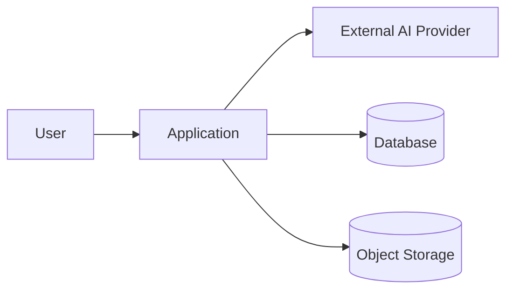
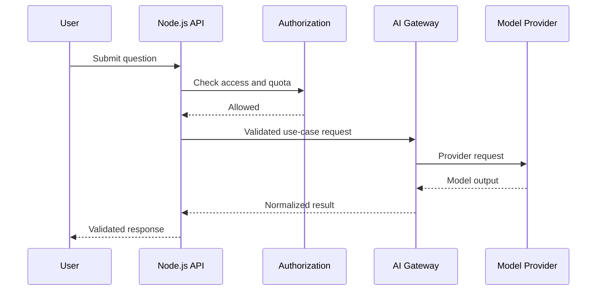

# Architecture Diagrams

Use diagrams to communicate boundaries and behavior. Mermaid is convenient for diagrams stored in Markdown and reviewed in Git.

## System context

## Sequence diagram

## Diagram checklist
- Show trust boundaries.
- Label synchronous vs asynchronous calls.
- Show data ownership and external dependencies.
- Include failure paths for critical workflows.
- Avoid placing secrets or real personal data in diagrams.
- Keep diagrams aligned with ADRs and implementation.
